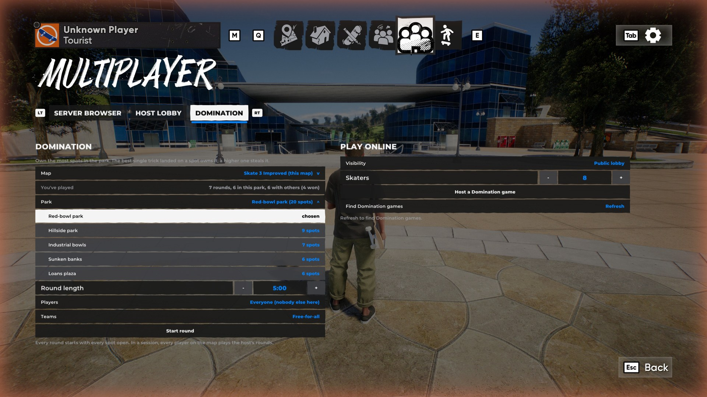
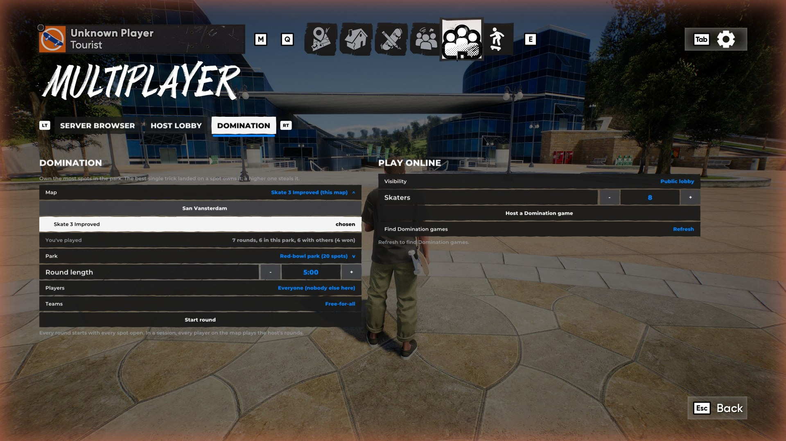
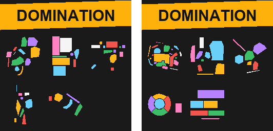

# Domination: a custom multiplayer mode

skate. 3's Domination, for ReSkate. Own the most spots in a park: the best single trick landed on a spot owns it, and a higher one steals it. Play alone, or with everyone in a session.


## What's in it

- **Rounds:** each skater starts at one of the park's starts, facing the park. A 3-2-1-GO countdown, then the clock runs (5 minutes by default).
- **On screen:**
  - markers over the spots in their owner's colour, with name and score;
  - each nearby spot's edge glowing faintly on the ground, hidden behind walls;
  - arrows to the nearest spots you don't own;
  - the timer, the spot list and the standings;
  - a feed of who did what, a small banner each in that player's colour ("YOU STOLE Deep end FROM Kush"), with sounds for taking and losing a spot.
- **Results:** the winner (most spots; ties go to points), standings with spots, time held, steals and points, the best trick, the most steals, the longest held, and who owns what. They come in one after another: the winner's band, the rows sliding in with their points counting up, then award cards.
- **Teams** (an option): red against blue, balanced and never reshuffled.
- **Ten parks built in**, every spot checked in game:
  - five on San Vansterdam, where the game puts its own skate challenges: Rolling Waves, Bonski Park under the bridge, Hartcore Plaza, FlowTopia and El-One Courts;
  - five on the Skate 3 map mod: the red-bowl park, Hillside park, Industrial bowls, Sunken banks and Loans plaza.
- **More parks as mods:** no pull request needed. A map mod can ship its own park file, and a park pack is a mod of park files alone (a `domination` folder; no game data), installed from the launcher's MODS page. Only mods switched on count. A park on a map that isn't installed says what to get.
- **Its own tab** on the Multiplayer page, when "Custom Multiplayer" (#2) is in: Map and Park dropdowns (each map marked when it isn't installed), round length, players, teams, and Start round.
- **Play counts:** each player's rounds played to the end, in all, with others and won, per map and per park. `domination stats` and the tab show them. They're saved in the player's own profile and never sent anywhere.
- **Multiplayer:** the session's host runs the rounds, and every player on the map is in them, late arrivals too.
  - Messages ride in the throwdown packets, so there's **no server, relay or protocol change**.
  - Every copy ends with the same owners and results whatever order messages arrive in.

| | |
|---|---|
|  |  |
|  |  |

| | |
|---|---|
|  |  |


## Making parks, and packaging them as mods

`Extension/Domination/MAKING-PARKS.md` goes through it step by step. In short:

1. **Find the place:** `trainer where`, `domination tp <x> <y> <z> [heading]`, or `domination survey <places file>` to visit many places unattended.
2. **Measure it:** `domination scan <x0> <z0> <x1> <z1> 0.25` writes a height map (stand there first: the game loads collision only near the skater); `tools/render_scan.py` draws it from above.
3. **Draw the spots:** a spec of footprints (polygons, or capsules for rails and ledges) and starts. The nine specs the built-in parks came from are in `parks/specs/`.
4. **Build the park file:** `tools/build_park.py spec scan.npz park.json park.png` measures each spot's heights and marker from the scan and checks for overlaps. (Rebuilding Sunken banks from its spec gives the shipped file exactly.)
5. **Try it:** copy it to `%LOCALAPPDATA%\ReSkate\domination\parks\`; `domination parks`, `domination status` on each spot, a solo round.
6. **Share it, with no pull request:**
   - **a park pack:** `tools/make_pack.py out My_Parks 1.0.0 "..." park.json...` writes a Thunderstore zip (manifest, readme, icon, `domination/*.json`), installed from the launcher's MODS page;
   - **inside a map mod:** `domination-<id>.json` beside its manifest;
   - **built in:** add it to `parks/` and run `tools/make_builtin.py` (that one is a pull request).

The ten built-in parks also come as two packs made this way, ready to upload: `Domination_Parks_San_Vansterdam` and `Domination_Parks_Skate_3_Improved` (on the notes branch). A pack's park overrides the built-in park of the same id, so the shipped parks can be updated between ReSkate releases.



## Try it

From the console (`~`):

```
domination parks
domination set map next
domination start solo 60
domination stats
domination scan 330 440 345 455 0.5   # stand in the red-bowl park first
```

## Tested

- **Unit tests:** park files, every built-in park, trick reading, the board, results, teams and the wire format. ReSkate's whole suite passes with it.
- **Network tests:** whole rounds between up to 16 simulated players over a bad network (lag, loss, duplicates, clock drift, late joins, leaves, the host leaving, two rounds at once). 1,343 checks.
- **Fuzz:** 11,000 random rounds with 0 disagreements.
- **GCC 13:** builds and passes too.
- **In game:** rounds on San Vansterdam and the Skate 3 map mod, offline, with practice bots running the same multiplayer rules. Every bot's copy of each round agreed with the player's.
- **Play counts:** a round with bots and a solo round counted (1 with others, 2 in all, on the right map and park), and still there after a restart.
- **Live, two players:** played online between two PCs (two Steam accounts, ReSkate 2.1 built from these branches, a join-code lobby hosted from the DOMINATION tab): rounds ran for both players.
- **Known limitation:** Start round leaves the pause menu open; close it (Esc) to play. ReSkate has no call that closes the pause menu from code. If you add one, the tab can close it itself.

## For reviewers and agents

- **Start here:** `Extension/Domination/ARCHITECTURE.md` says where the rules are, every touchpoint outside the folder, and the invariants that keep players in agreement.
- **Base:** built and tested against the official ReSkate 2.1.0 release (`v2.1.0`) and against `main` at `99467f4` (2026-10-17), the same way on both: the unit and network tests, `fuzz 1000`, and practice-bot rounds in game. The branch is on `main` and applies to `v2.1.0` as it is.
- **Applying:** `AGENT-GUIDE.md` (submission folder) lists every line this adds to existing files, the conflicts that can happen, and how to check the result.
- **With the menu:** this works alone, from the console. With "Custom Multiplayer" (#2) in the tree, it also gets its own tab (`domination_menu.cpp`, built only then: `cmake/Runtime.cmake` sets `DINGOSDK_CUSTOM_MODES` when `Extension/CustomModes/custom_modes.h` exists). Nothing else is needed, in either merge order.

🤖 Generated with [Claude Code](https://claude.com/claude-code)
