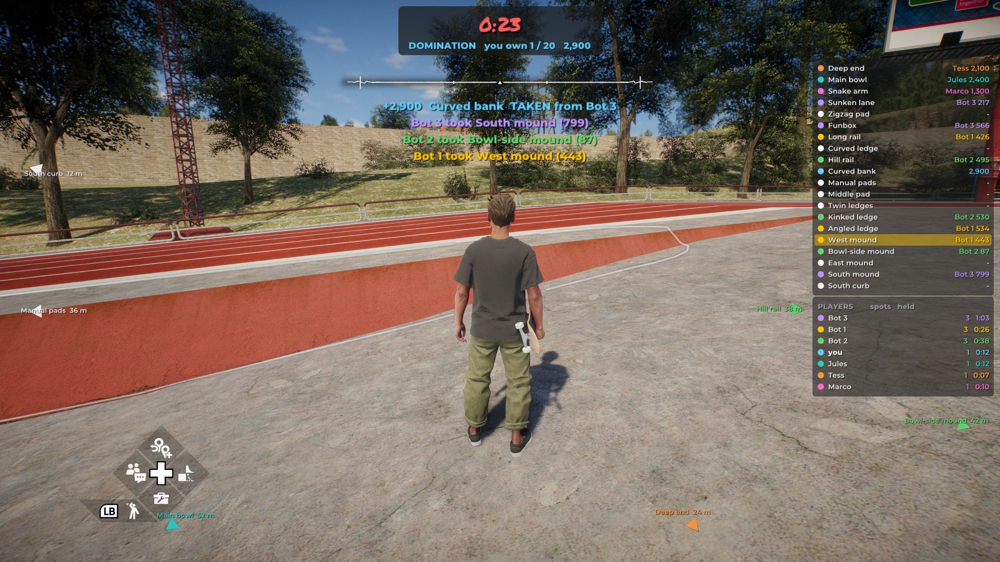
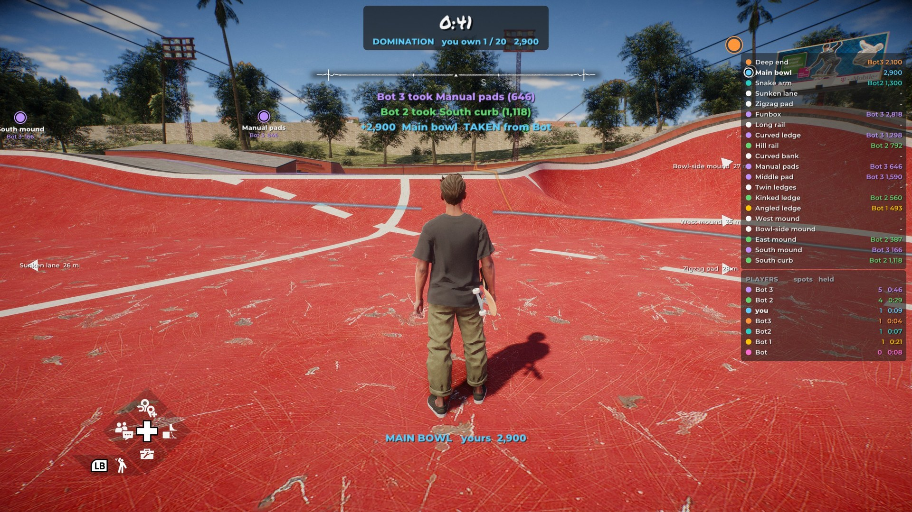
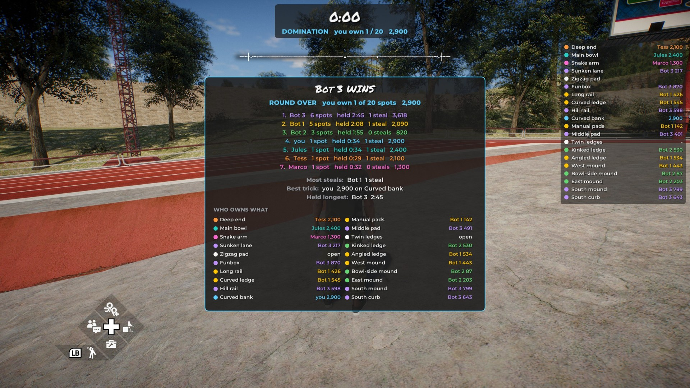
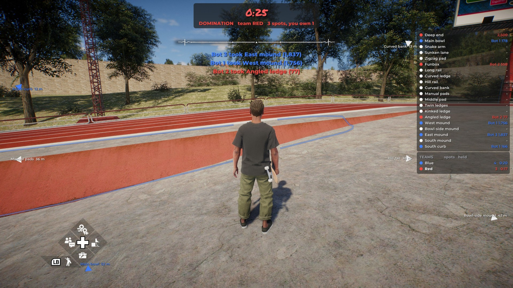
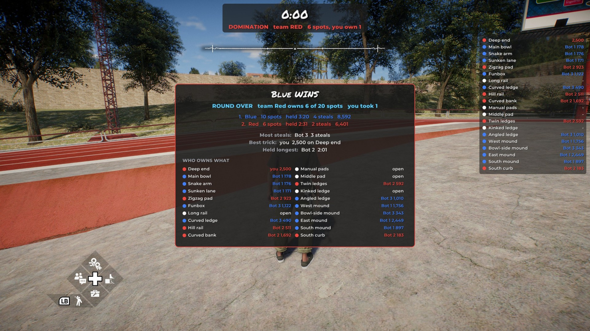
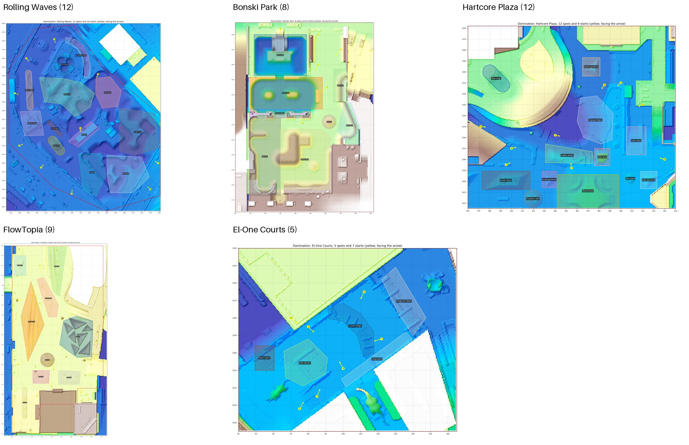
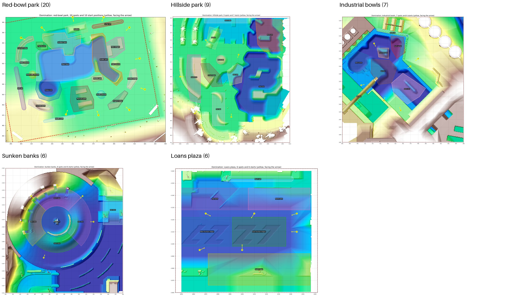

# Domination: a custom multiplayer mode

skate. 3's Domination, for ReSkate. Own the most spots in a park: the best single trick landed on a spot owns it, and a higher one steals it. Play alone, or with everyone in a session.



## What's in it

- **Rounds:** each skater starts at one of the park's starts, facing the park. A 3-2-1-GO countdown, then the clock runs (5 minutes by default).
- **On screen:**
  - markers over the spots in their owner's colour, with name and score;
  - each nearby spot's edge glowing faintly on the ground, hidden behind walls;
  - arrows to the nearest spots you don't own;
  - the timer, the spot list and the standings;
  - a feed of every claim in the claiming player's colour, with sounds for taking and losing a spot.
- **Results:** the winner (most spots; ties go to points), standings with spots, time held, steals and points, the best trick, the most steals, the longest held, and who owns what.
- **Teams** (an option): red against blue, balanced and never reshuffled.
- **Ten parks built in**, every spot checked in game:
  - five on San Vansterdam, where the game puts its own skate challenges: Rolling Waves, Bonski Park under the bridge, Hartcore Plaza, FlowTopia and El-One Courts;
  - five on the Skate 3 map mod: the red-bowl park, Hillside park, Industrial bowls, Sunken banks and Loans plaza.
- **Parks from files:** a map mod can ship its own park file. A park on a map that isn't installed says what to get.
- **Its own tab** on the Multiplayer page, when "Custom Multiplayer" (#2) is in: Map and Park dropdowns (each map marked when it isn't installed), round length, players, teams, and Start round.
- **Play counts:** each player's rounds played to the end, in all, with others and won, per map and per park. `domination stats` and the tab show them. They're saved in the player's own profile and never sent anywhere.
- **Multiplayer:** the session's host runs the rounds, and every player on the map is in them, late arrivals too.
  - Messages ride in the throwdown packets, so there's **no server, relay or protocol change**.
  - Every copy ends with the same owners and results whatever order messages arrive in.

| | |
|---|---|
|  |  |
|  |  |




## Try it

From the console (`~`):

```
domination parks
domination set map next
domination start solo 60
domination stats
```

## Tested

- **Unit tests:** park files, every built-in park, trick reading, the board, results, teams and the wire format. ReSkate's whole suite passes with it (52 of 52 on `main`).
- **Network tests:** whole rounds between up to 16 simulated players over a bad network (lag, loss, duplicates, clock drift, late joins, leaves, the host leaving, two rounds at once). 1,343 checks.
- **Fuzz:** 11,000 random rounds with 0 disagreements.
- **GCC 13:** builds and passes too.
- **In game:** rounds on San Vansterdam and the Skate 3 map mod, offline, with practice bots running the same multiplayer rules. Every bot's copy of each round agreed with the player's.
- **Play counts:** a round with bots and a solo round counted (1 with others, 2 in all, on the right map and park), and still there after a restart.
- **Not yet tried:** two real players online.

## For reviewers and agents

- **Start here:** `Extension/Domination/ARCHITECTURE.md` says where the rules are, every touchpoint outside the folder, and the invariants that keep players in agreement.
- **Applying:** `AGENT-GUIDE.md` (submission folder) lists every line this adds to existing files, the conflicts that can happen, and how to check the result.
- **With the menu:** this works alone, from the console. With "Custom Multiplayer" (#2) in the tree, it also gets its own tab (`domination_menu.cpp`, built only then: `cmake/Runtime.cmake` sets `DINGOSDK_CUSTOM_MODES` when `Extension/CustomModes/custom_modes.h` exists). Nothing else is needed, in either merge order.

🤖 Generated with [Claude Code](https://claude.com/claude-code)
